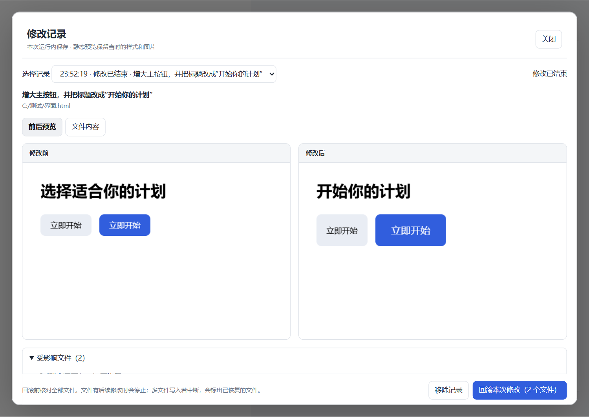
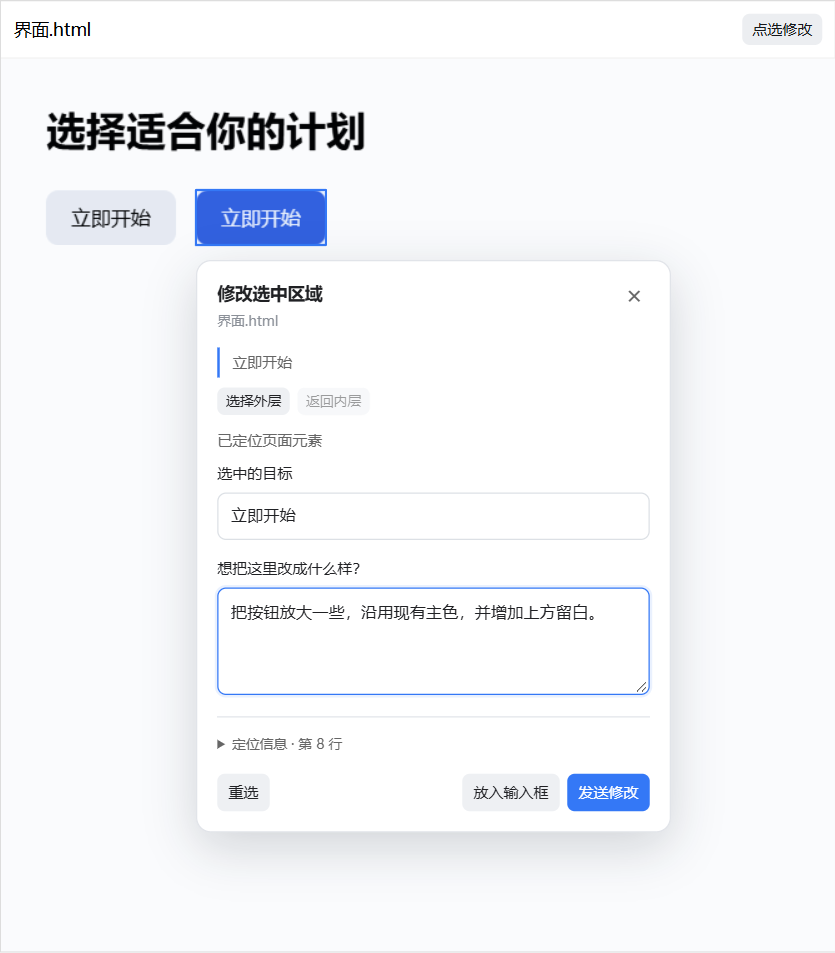
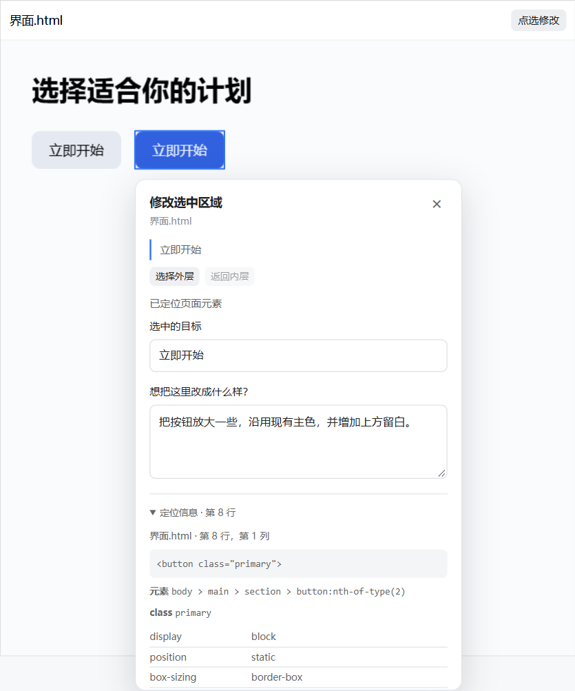
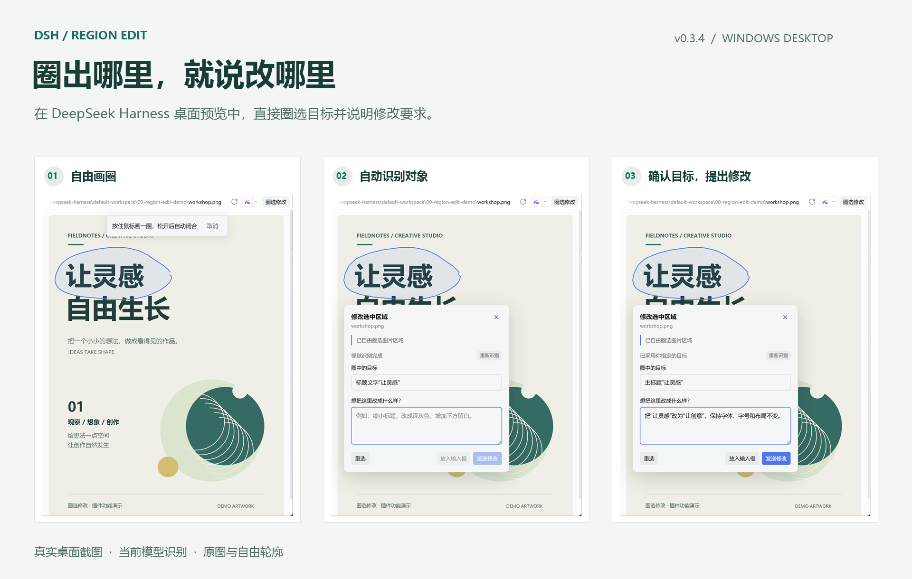
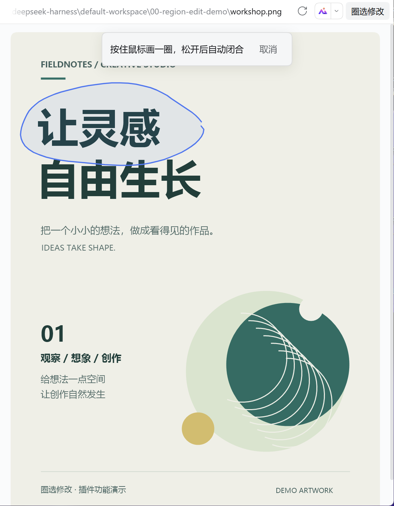
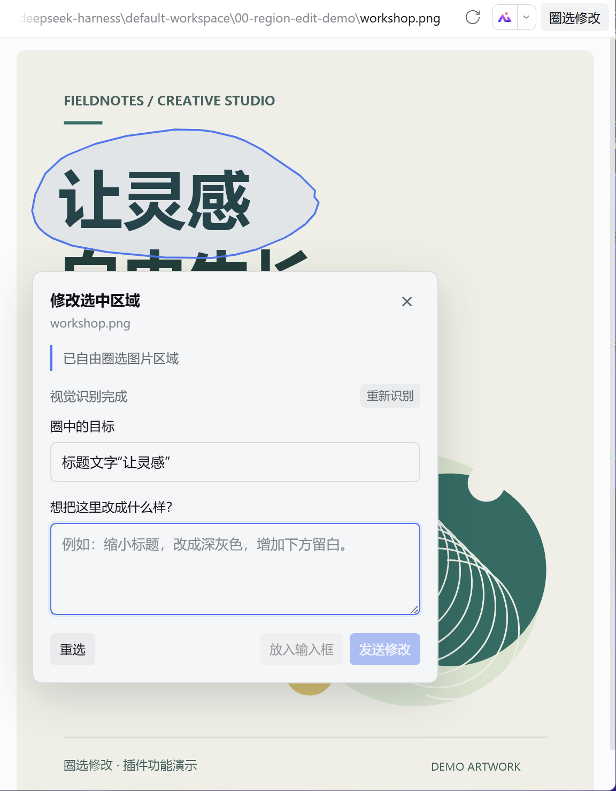
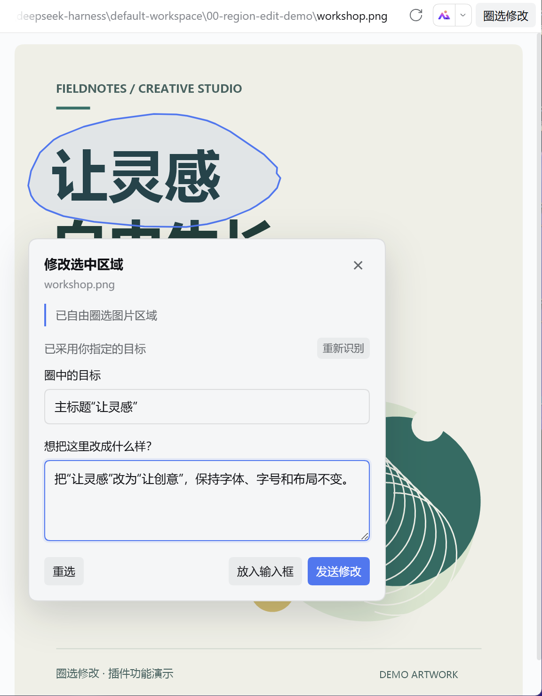

# 点选与圈选修改 · DeepSeek Harness 桌面插件

在右侧预览中点选网页元素，或自由圈选图片与文字，写下要求，发送给当前会话。不截图、不录屏，图片直接使用原文件。

- **本地网页**：点选元素，定位到原始 HTML 的行列，并附带 class、匹配的样式规则和 CSS 变量，让模型优先复用现有样式。
- **图片与文字**：沿目标自由画圈，图片由当前会话的视觉模型识别圈中对象。
- **修改记录**：从本地 HTML 发起的修改会保存前后对比，可以一键回滚，重启 Harness 后仍然可用。

## 功能演示

**v0.5.0：修改前后对比与回滚**



本图来自生产构建的 Chromium 交互测试，使用测试文件模拟模型修改。宿主契约测试另行使用本机 DSH 的真实文件服务完成 HTML/CSS 写回与冲突拦截；并未将模拟结果标为真实模型修改结果。

**v0.4.0：网页点选与源码定位**



点击目标、切换外层或内层，再写下修改要求。定位信息默认折叠，展开后可以检查原始 HTML 行列、class 和关键样式。这张图来自插件生产构建的 Chromium 测试页面；Windows DSH 桌面端已另行验收点选、源码位置、外层切换及放入输入框，未发送模型修改请求。可下载 [独立 HTML 演示页](https://github.com/a961282799-crypto/dsh-region-edit/blob/main/docs/examples/point-selection-demo.html) 本地体验。

<details>
<summary>展开查看源码与样式信息</summary>



</details>

**图片自由圈选：v0.3.4 桌面实机演示**



1. **自由画圈**：沿目标画出任意轮廓，松开后自动闭合。
2. **识别对象**：当前视觉模型直接读取原图，填入圈中的对象名称。
3. **说明修改**：确认或纠正目标，再写下修改要求，发送或先放入聊天输入框。

<details>
<summary>查看三张桌面原始截图</summary>

**自由圈选**



**视觉识别**



**确认目标并填写修改要求**



</details>

演示来自 Windows 桌面端，插件版本为 v0.3.4，目标名称由当前模型实际返回。截图中的修改要求停在提交前。演示原图、截图说明见 [功能截图](https://github.com/a961282799-crypto/dsh-region-edit/blob/main/docs/screenshots.md)。

## 安装

已适配 **DeepSeek Harness 0.2.2-rc.1 / Windows**。插件版本 v0.6.0。

**一键安装**：双击项目根目录的 `安装到 Harness.cmd`。脚本会检查 Harness 版本是否匹配，询问后关闭 Harness，安装 `artifacts` 中对应版本的安装包（没有就先打包），再重新打开 Harness。

**手动安装**：安装包和 SHA-256 在 [GitHub 发布页](https://github.com/a961282799-crypto/dsh-region-edit/releases)，npm 上的包名是 `dsh-region-edit`。用 Harness 自带的命令行安装：

```powershell
& '<Harness 安装目录>\resources\runtime\cli\bin\dsh.cmd' plugin --profile desktop add '<安装包完整路径>\dsh-region-edit-0.6.0.tgz'
```

安装后重新打开桌面客户端。无需修改宿主程序、开启调试端口或启动独立服务。

## 使用

**本地网页**

1. 在 HTML 文件的预览方式中选择 **圈选预览**，点击 **点选修改**。
2. 鼠标移到目标上会显示边框，点击锁定。点中按钮或链接里的文字时，先选中整个按钮；用 **选择外层 / 选择内层** 调整范围，内层可以一直回到实际点中的位置。
3. 填写要求后 **发送修改**（`Ctrl+Enter`），或 **放入输入框** 先检查。**定位信息** 默认折叠，展开可查看源码位置、class 和样式。也可以切换到自由圈选。

**图片与其他文件**

1. 在会话右侧打开文件预览，点击 **圈选修改**，按住鼠标沿目标画一圈，松开自动闭合。
2. 图片会交给当前会话的视觉模型识别，在「圈中的目标」里确认或纠正名称；识别时也可以 **停止识别，手动指定**。
3. 勾选 **附带轮廓标记图** 后，插件用原图生成一张缩小的标记图，红框标出你的轮廓，随识别和修改请求一起发送，帮助模型定位。这不是屏幕截图，默认关闭，选择会记在本机。
4. 填写要求后发送。`Esc` 取消圈选；发送失败时保留已填写的内容。

**查看与回滚**

点击工具栏的 **修改记录**，查看修改前后的静态预览，或切到「文件内容」逐行查看改动。**回滚本次修改** 会先核对整批文件，任何一个文件在这轮结束后又被改过就停止，不会只恢复一部分。

以下情况照常发送，但这次修改没有记录、不能一键回滚，发送后会提示原因：会话正在运行、同一会话已有进行中的记录、文件超出记录上限。记录满时会自动删除最旧的已结束记录。

详细的记录规则、上限、预览与定位范围、架构说明见 [docs/details.md](docs/details.md)。

## 已知限制

- 图片的修改由当前会话的编辑工具完成，视觉识别不等于已经改好图片；图片文件不支持回滚。
- 圈选预览只加载本地文件和本地关联资源，不访问网络。依赖 CDN、远程接口或嵌套框架的页面请用宿主原来的预览方式。
- 预览始终以标准模式渲染（`srcdoc` 框架的规定），没有 doctype 的旧页面在浏览器里可能显示得不同。
- 没有文字层的 PDF、Canvas 绘图和浏览器标签中的外部网站暂不支持。

## 开发与验证

需要 Node.js 22.18+（测试直接运行 TypeScript）。首次运行 `npm ci`。

```sh
npm run check        # 类型检查、构建、单元测试、浏览器交互测试、宿主契约检查
npm run pack:plugin  # 先运行全部检查，再生成 artifacts/dsh-region-edit-<版本>.tgz 和 SHA256SUMS
```

- 交互测试使用 Playwright，可用 `PLAYWRIGHT_CHROMIUM_EXECUTABLE` 指定已有的 Chromium；`DSH_DEV_DEPS` 可以指向已有的开发依赖目录。
- 宿主契约检查用 Electron 的 Node 模式加载真实宿主模块，默认查找 `D:/deepseek harness/DeepSeek Harness.exe`，其他位置用 `DSH_HOST_EXECUTABLE` 指定。缺少宿主或检查失败时会阻止打包。
- GitHub Actions 在每次推送时运行除宿主契约检查以外的全部检查（`.github/workflows/check.yml`）。
- `src/host.ts` 集中声明插件使用的宿主接口。升级 Harness 后先核对这些接口，再更新兼容声明。

版本改动见 [CHANGELOG.md](CHANGELOG.md)，每个版本的验证过程见 [VALIDATION.md](VALIDATION.md)。插件只提交修改请求，具体修改由当前会话的模型与工具完成。
