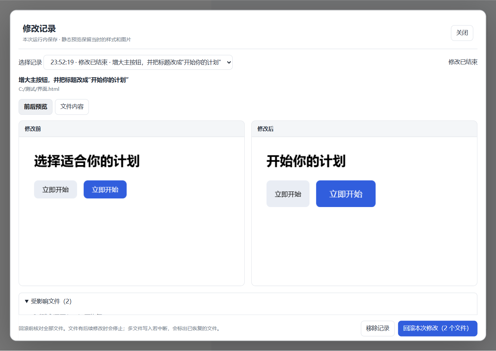

# 点选与圈选修改 · DeepSeek Harness 桌面插件

在右侧预览中点选网页元素，或自由圈选图片与文字，写下要求，发送给当前会话。**不截图、不录屏；图片直接使用原文件。**

v0.5.0 新增本地 HTML 的 **修改记录、前后预览与一键回滚**。发送或放入输入框前保存原内容；要求进入当前会话的对应轮次后开始跟踪，轮次结束自动保存结果。HTML、CSS、图片和字体使用各自当时的内容生成静态对比；切换「文件内容」按行显示改动（红色删除、绿色新增，未改动的部分折叠，可展开）。v0.5.1 起已结束的记录保存在本机，重启 Harness 后仍可查看和回滚。

保留 v0.4.0 的点选、悬停高亮、外层/内层切换、原始 HTML 行列和源码片段。请求包含 class、关键样式、CSS 变量和父布局，优先复用现有样式。开发服务器、React/Vue 源码映射及自动多视口检查仍属于后续阶段。

## 功能演示

**v0.5.0：修改前后对比与回滚**



本图来自生产构建的 Chromium 交互测试，使用测试文件模拟模型修改。宿主契约测试另行使用本机 DSH 的真实文件服务完成 HTML/CSS 写回与冲突拦截；并未将模拟结果标为真实模型修改结果。

**v0.4.0：网页点选与源码定位**


点击目标、切换外层或内层，再写下修改要求。定位信息默认折叠，展开后可以检查原始 HTML 行列、class 和关键样式。这张图来自插件生产构建的 Chromium 测试页面；Windows DSH 桌面端已另行验收点选、源码位置、外层切换及放入输入框，未发送模型修改请求。可下载 [独立 HTML 演示页](https://github.com/a961282799-crypto/dsh-region-edit/blob/main/docs/examples/point-selection-demo.html) 本地体验。

<details>
<summary>展开查看源码与样式信息</summary>


</details>

**图片自由圈选：v0.3.4 桌面实机演示**


1. **自由画圈**：沿目标画出任意轮廓，松开后自动闭合。
2. **识别对象**：当前视觉模型直接读取原图，填入圈中的对象名称。
3. **说明修改**：确认或纠正目标，再写下修改要求，发送或先放入聊天输入框。

<details>
<summary>查看三张桌面原始截图</summary>

**自由圈选**


**视觉识别**


**确认目标并填写修改要求**


</details>

演示来自 Windows 桌面端，插件版本为 v0.3.4，目标名称由当前模型实际返回。截图中的修改要求停在提交前。演示原图、截图说明见 [功能截图](https://github.com/a961282799-crypto/dsh-region-edit/blob/main/docs/screenshots.md)。

## 安装到桌面版

已适配的桌面版本：**DeepSeek Harness 0.2.1-rc.5 / Windows**（当前工作区插件 v0.5.2）。

已构建的安装包和 SHA-256 在 [GitHub 发布页](https://github.com/a961282799-crypto/dsh-region-edit/releases)，同一版本也发布在 npm（`dsh-region-edit`）。自行构建时运行 `npm run pack:plugin`，安装包生成于 `artifacts/dsh-region-edit-0.5.2.tgz`，同目录提供 `SHA256SUMS`。

```powershell
& 'D:\deepseek harness\resources\runtime\cli\bin\dsh.cmd' plugin --profile desktop add '插件包的完整路径\dsh-region-edit-0.5.2.tgz'
```

安装后重新打开桌面客户端。无需修改宿主程序、开启调试端口或启动独立服务。

## 使用

**本地网页：** 在 HTML 文件的预览方式中选择 **圈选预览**，点击 **点选修改**。鼠标移到目标上会显示边框，点击后锁定元素；用 **选择外层 / 返回内层** 调整范围。填写要求后发送，或先放入输入框。**定位信息** 默认折叠，可展开查看源码位置、class 和样式；也可在选择方式中切回自由圈选。

**查看与回滚：** 点击同一工具栏的 **修改记录**。本轮结束后自动出现左右预览及受影响文件列表；点击 **回滚本次修改** 恢复已备份的文字文件。恢复前先核对整批文件，再通过宿主的版本条件逐个写回。文件在本轮结束后又被编辑时，显示具体冲突并停止；若写入途中失败，会标明已恢复的文件，保留剩余文件以便重试。

若先「放入输入框」，记录显示「等待开始」。发送后会关联实际执行轮次。不再发送时可在记录中移除，或直接发起新的修改，未发送的旧记录会被自动替换；两者都不会改动项目文件。每个会话同时只保留一个待发送或执行中的请求，以免不同要求共用恢复基线；若被替换的旧请求仍和新请求一起发出，这条记录会标明不能单独回滚。

### 第二阶段的范围

- 从本地 HTML 发起；保存关联 CSS、CSS 导入、图片与字体，并捕获本轮原生文件工具即将修改的其他文件。宿主变更列表若报告未备份或重命名的文件，会阻止整批回滚。
- 恢复普通 UTF-8 文字文件，保留 BOM、CRLF 等原始内容；已删除的原文字文件仅在路径仍为空时重新创建。新增文件、变动的二进制资源及不完整记录会明确提示并停用回滚，避免仅恢复一部分却宣称完成。
- 对比是冻结内容的**静态预览**，不执行页面脚本，不代表 hover、弹窗或登录态，也不是系统截图。图片圈选的既有流程不变，本阶段不提供图片文件的回滚。
- 已结束、已回滚或标为“记录未完成”的记录保存在本机应用数据目录（Windows 为 `%APPDATA%\dsh-region-edit\history`），不写入项目文件夹；相同内容只存一份。尚未发送或正在执行的请求不保存，重启后需要重新发起。重启后回滚会逐字节核对文件仍是当时修改后的内容，一致才写回。
- 最多 8 条记录；文件每份最多 4 MiB，HTML 最多 1 MiB，单侧最多 33 个文件 / 16 MiB，总预算 64 MiB（为修改后内容预留空间）。记录满时，自动删除已回滚或结束超过 7 天的最旧记录；7 天内和正在进行的记录不会自动删除，此时提示手动移除。
- 同一工作区（包括上级或下级目录）有会话正在运行时，回滚会等本轮结束；其他文件夹中的会话不影响回滚。本轮运行期间应避免同时手动编辑同一批文件。无 Git 工作区中，宿主可能无法列出命令行改动的额外文件；回滚的覆盖范围以面板列出的文件为准。插件不使用 Git reset，不重置整个工作区。

**图片与其他文件：**

1. 在当前会话右侧打开一个文件预览，点击工具栏的 **圈选修改**。
2. 按住鼠标左键，沿目标画出任意轮廓；松开后自动闭合，不需要画矩形。
3. 图片会交给当前会话选中的视觉模型识别。查看「圈中的目标」，可以纠正名称或重新识别；识别时也能先填写修改要求，或点击 **停止识别，手动指定** 后直接填写目标并提交。文字预览直接定位轮廓内文字和元素。
4. 点击 **发送修改**，或按 `Ctrl+Enter`。也可以选择 **放入输入框**，先检查完整请求和原图附件。
5. DeepSeek 接收原图、实际自由轮廓及已确认的目标，沿用当前会话的编辑工具处理原文件；文件改变后由 Harness 的预览监听机制重新载入。

`Esc` 取消圈选。发送失败时保留输入，便于重试。已有聊天草稿和引用会保留，圈选请求追加在末尾。

调整窗口或预览区域大小后，旧选区失效，但已写的修改要求会保留，重新圈选即可继续。点击「重选」会重新读取文件版本和源码，文件更新后无需退出圈选功能再打开。小窗口中的修改面板支持滚轮滚动。

手动指定目标后，重选会保留手动模式和目标名称，名称作为待确认草稿显示。确认沿用或修改名称后即可提交；点击「重新识别」才会恢复自动识别。取消圈选或切换文件会清除这份草稿。轮廓发生交叉时会提示重新沿目标外围画圈。

如果预览内容是隔离的页面文件，在宿主的预览方式下拉菜单中选择 **圈选预览**，再使用同一个圈选按钮。它仍然运行在桌面客户端内部。

## 支持范围

- 文字、Markdown、代码及带有可读取文字层的预览。
- 图片：保存自由轮廓及原图像素、归一化坐标；PNG、JPEG、WebP、GIF 直接通过宿主原生视觉输入进行识别，发送修改时附带原图。没有截图、裁剪图或标记图。SVG 等其他预览提供文件引用和自由轮廓。
- 桌面文件预览中的页面元素：通过「圈选预览」点选或圈选。支持文字、按钮、SVG 图标、图片和空白容器；点选不会触发页面按钮的点击动作。点选使用临时元素标识，节点被替换后会要求重选。
- PDF、Office 转换预览：取决于宿主是否渲染了可读取的文字层。发送原文件路径、选中文字及能够获取到的页码；不声称能定位二进制文件的源码行。

识别使用当前会话的模型与现有登录，不需要配置另一套密钥或本地视觉模型。识别只返回对象名称、文字及不确定性，不执行编辑，也不向聊天发送测试消息；图片在自动识别模式下每次圈选或重新识别会产生一次模型请求。识别失败时可以手动填写目标继续；不确定时会提示确认。自由轮廓外的文字不会按外接矩形混入选中内容；祖先容器完全透明或被滚动容器裁剪隐藏的文字也不会作为选中文字提交。

在图片外的留白区域圈选会提示重选。缩放或文件变化后需要重新圈选。图片最终修改仍由当前会话的编辑工具执行，模型识别不等同于已经改好图片。没有文字层的 PDF、Canvas 绘图和桌面浏览器标签中的外部网站暂不支持。

圈选预览只加载本地文件及受限的本地关联资源，不访问网络。它不能代替完整浏览器：依赖 CDN、远程接口、嵌套框架、动态模块导入或内联事件处理器的页面应继续使用宿主原来的预览方式。页面脚本是否运行仍受 Harness 的代码工作工具开关控制。

本地 CSS 支持背景图、WOFF/WOFF2/TTF/OTF 字体及嵌套 `@import`，资源相对路径按引用它的样式表解析。重复资源复用一次读取，循环样式引用会跳过重复的那条引用。最多加载 32 个关联文件，每个不超过 4 MB、合计不超过 16 MB；这些资源会加入宿主的文件变化监听。

静态 HTML 源码位置由内置解析器在资源改写前记录，可区分文字相同的元素；浏览器自动补出的节点不伪造行号。精确映射限 1 MiB 文本和最多 12,000 个有原始标签的节点。启用原页面脚本时，因脚本可能提前替换节点，该页面保留结构和样式定位，但不声称精确静态映射；后来新增或克隆的节点也不会继承原节点的位置。普通文字文件仍提供文字匹配候选。

样式信息为当前视口的有界参考：21 项关键计算属性、按层叠顺序最后匹配的至多 8 条规则（从最后加载的样式表倒序查找，大型框架之后的自定义样式也能找到）、12 个被引用的 CSS 变量及一层父容器布局。直接加载的 CSS 会注明文件；内嵌或嵌套导入中无法确认的来源不猜文件或行号。这不是完整的 CSS 层叠分析，不覆盖伪元素、容器查询等全部规则。发送前会重新核对文件、元素身份和提取内容，发生变化则保留要求并提示重选。

## 架构

一个桌面插件包：界面复用宿主 React，宿主端仅提供一个可取消的只读识别方法。通过公开的 `slots`、`documentPreviews`、`sessions`、`workspaceFiles`、`attachments` 和 `llm` 接口工作。没有独立服务、系统截图通道、另一套模型 API 或额外运行依赖。

鼠标轨迹用 SVG 显示并保留为多边形；精简采样点后，对文字逐字判断是否与轮廓相交。图片把轮廓直接映射到原图。识别请求通过宿主自带 Connection/Remote 通道绑定当前会话，使用当前模型的图片输入；取消、重选、卸载和超时都会结束请求。外接范围仅用于定位输入框和辅助工具，不替代自由轮廓。

圈选通过文字实际排版位置提取，并结合元素定位。HTML 点选通过隔离页面内的命中检测获得元素，原始标签位置由构建时打包的 parse5 提供。精确标签位置与文字搜索候选分开传递；预览与读取文件内容不一致时阻止使用旧位置。发送前重新检查文件版本、会话、标签页、选区内容和样式。

隔离预览通过 `MessageChannel` 提供只读圈选、点选和元素查询；保持 `sandbox="allow-scripts"` 且不授予 `allow-same-origin`，禁止网络连接。来自预览的数据有形状和大小校验；源码行号从父页面保存的解析索引补入，不接受 iframe 自报行号。该通道不具有文件读取、会话发送或执行宿主命令的权限。

`dsh.client.platform: "web"` 是 Harness 桌面端共用界面加载器的名称；本插件会检查桌面桥接对象，在独立 Web 客户端中不启用。

## 开发与验证

需要 Node.js 22.18+（测试直接运行 TypeScript 文件）、开发依赖和已安装的目标 Harness 桌面版本。首次用 `npm ci` 安装锁定的开发依赖。parse5 在构建时打包进客户端，不要求宿主另行安装。仅检查时执行 `npm run check`；生成发布包执行下面的命令，它会先运行全部检查：

```sh
npm run pack:plugin
```

交互检查使用 Playwright，可通过 `PLAYWRIGHT_CHROMIUM_EXECUTABLE` 指定已有 Chromium。所有检查均不截图。`DSH_DEV_DEPS` 可指向已有开发依赖目录，避免重复安装。

统一检查包含类型检查、构建、基础逻辑、浏览器交互及真实宿主模块契约检查。宿主检查通过 Electron 的 Node 模式运行，同时核对实际宿主兼容判定、运行依赖版本及客户端依赖包；使用测试替身提供文件和模型回复，不调用真实模型。默认查找 `D:/deepseek harness/DeepSeek Harness.exe`；其他安装位置请设置 `DSH_HOST_EXECUTABLE`，必要时用 `DSH_HOST_PACKAGE` 指定宿主的 `dsh/package.json`。缺少宿主、版本不符或契约检查失败时会阻止打包。

`src/host.ts` 集中声明本插件实际使用的宿主接口；升级 Harness 后应重新核对这些契约并更新兼容声明，不要跳过宿主的版本检查。

验证记录见 [VALIDATION.md](VALIDATION.md)。本插件提交修改请求；具体修改结果仍由当前会话的模型与工具完成。
