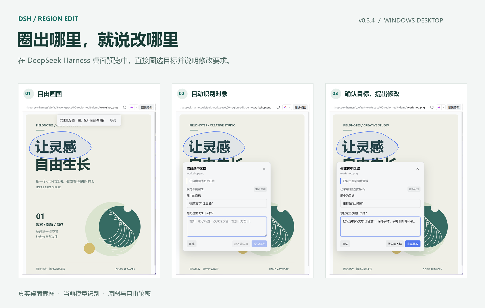
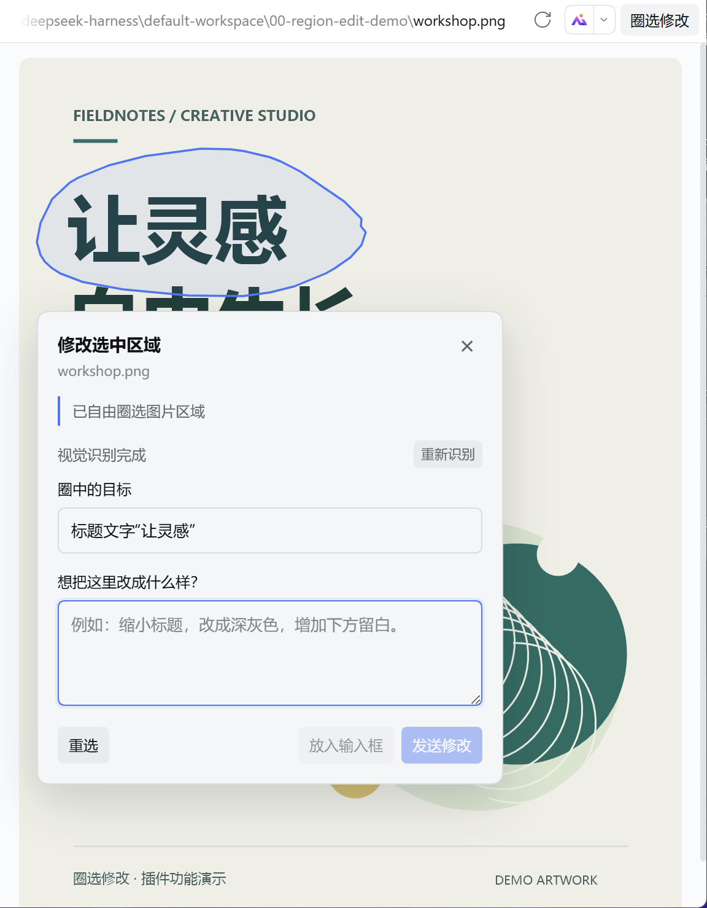
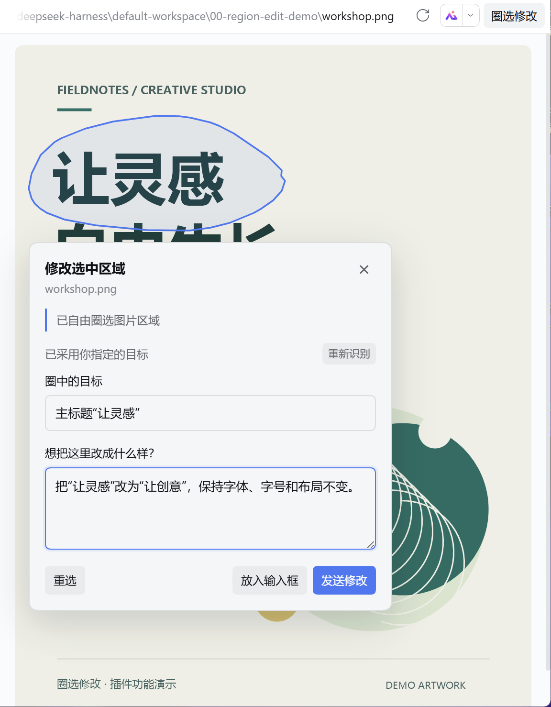

# 圈选修改：桌面功能演示

这些截图拍摄于 2026-10-24，使用 DeepSeek Harness Desktop 0.2.1-rc.3 与圈选修改插件 v0.3.4。画面只包含文件预览与插件界面，演示海报是独立制作的示例。

## 1. 自由画圈

点击「圈选修改」，按住鼠标沿目标外围画一圈。轮廓不需要是矩形，松开后自动闭合。

## 2. 自动识别对象

插件把原图与自由轮廓交给当前会话选中的视觉模型。此次实际返回的对象名称为「标题文字“让灵感”」。可以直接采用、重新识别，或手动纠正。

## 3. 确认目标，说明修改

目标名称可编辑。写下自然语言要求后，点击「发送修改」提交给当前会话，或选择「放入输入框」先检查。示例要求是：把“让灵感”改为“让创意”，保持字体、字号和布局不变。

截图停在提交前，没有执行这次图像修改。实际修改由当前会话的编辑工具完成。插件在操作中直接读取原图，不需要用屏幕截图来定位目标。

[下载演示原图](examples/workshop.png) · [回到 README](../README.md)
